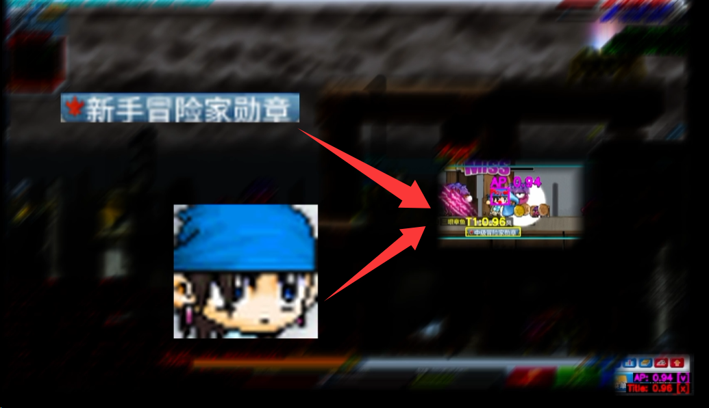
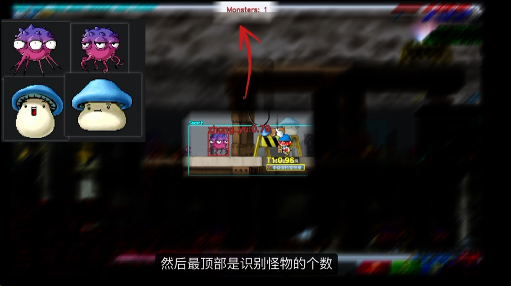
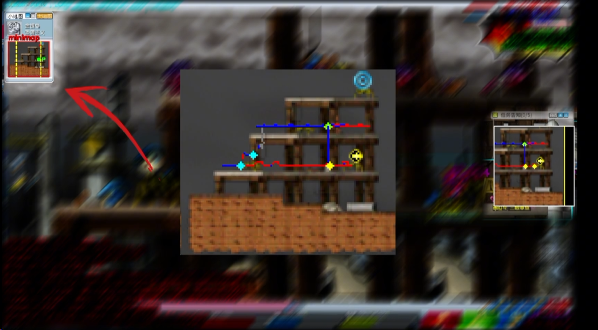

# Foreword

> [中文文档](./README.md)

* This project is based on [MapleStoryAutoLevelUp](https://github.com/KenYu910645/MapleStoryAutoLevelUp).
* Works with most 079/083 private servers (CN nostalgic servers, classic world, etc.).
* For recording and sharing only.

## Completed Features

- [x] Character recognition
- [x] Monster recognition
- [x] Minimap selection + Map drawing (route recording)
- [x] Auto HP/MP recognition & potion use
- [x] Auto farming (walking, attacking, skills)
- [x] Warning (lie detector / anti-cheat alert)
- [ ] Client application (GUI)

## Demo Video

GIF preview (first 30 seconds):


---

# 1. Character Recognition (Player Localization)



## Files

| File | Purpose |
|------|---------|
| `character/fashi.png` | Character **appearance** template (primary, blue character) |
| `character/title.png` | Character **title** template (fallback) |

## Config (`config/config_custom.yaml`)

Priority: **appearance first, title as fallback**.

```yaml
appearance:                    # appearance localization (fashi.png)
  enable: true
  template: "character/fashi.png"
  match_threshold: 0.85        # CCORR score; >=0.85 use appearance, <0.85 use title

title:                         # title localization (title.png)
  enable: true
  mode: "grayscale"            # grayscale / white_mask
  match_threshold: 0.28        # SQDIFF score; <0.28 = matched (lower is better)
```

- Bottom-right shows `AP: x.xx [v]` (appearance score) and `Title: x.xx [x]` (title score); `[v]` marks which one is currently used.
- When the appearance score drops below 0.85 (e.g. during attack animation), it automatically falls back to title localization.

---

# 2. Monster Recognition



## Files

Monster assets go under `monster/`, **one folder per monster**:

```
monster/
  zhang_yu/
    move_0.png
    move_1.png
    ...
  lan_mo_gu/
    stand_0.png
    move_0.png
    ...
```

- Asset download: [https://maplestory.wiki/GMS/83/mob/1110101](https://maplestory.wiki/GMS/83/mob/1110101)
- Put the monster's walk/stand images into its folder.

## Config (`config/config_custom.yaml`)

```yaml
monster_detect:
  mode: "color"                # color / grayscale / contour_only
  diff_thres: 0.25             # global default match threshold (lower = stricter)
  scales: [1.1]                # global default scales
  min_color_spread: 30         # min color purity (filters clouds / false positives)

  # per-monster config (key = folder name)
  monsters:
    zhang_yu:
      diff_thres: 0.302
      scales: [1.1, 1.2]
    lan_mo_gu:
      diff_thres: 0.20
      scales: [1.1]
      min_color_spread: 30     # dark monsters can lower this, e.g. 0
```

- Each monster's `diff_thres` / `scales` / `min_color_spread` overrides the global default.
- Monster box color: **brown-red `(42,42,165)`**, labeled `monster_name:similarity`.
- Top-center shows `Monsters: N` (recognized monster count).

---

# 3. Minimap Selection + Map Drawing (Route Recording)



## 3-1. Minimap Selection

In the monitor (NewMaple) window:

1. Press **`m`** → enter selection mode (a 3x magnifier appears in the top-right to help align the border).
2. Hold left mouse button and **drag to box the minimap**, release to confirm.
3. The console prints `[Minimap] → 写进 config: x=... y=... width=... height=...`; copy these 4 values into the `minimap` section of `config_custom.yaml`.

```yaml
minimap:
  fixed: true                  # true = use the fixed coords below
  x: 23
  y: 130
  width: 122
  height: 106
  player_color: [136, 255, 255]  # player yellow dot BGR (#ffff88)
  player_tolerance: 8
  width_boundary_pct: 0.6      # player may only move within the middle 30%~70% (0=off)
```

- The minimap is marked with a **red box**, the player dot with a **green `P`**, and the movement boundary with **yellow dashed lines**.

## 3-2. Map Drawing (Route Recording)

```bash
.venv/Scripts/python.exe tools/routeRecorder.py --new_map duoluozhuyi --cfg custom
```

Arguments:
- `--new_map`: map name (output goes to `minimaps/<map_name>/`)
- `--cfg`: which config to use (`custom` = `config_custom.yaml`)

**Continue an existing map (without overwriting)**:
```bash
.venv/Scripts/python.exe tools/routeRecorder.py --new_map duoluozhuyi --cfg custom --map minimaps/duoluozhuyi/map.png
```

Recording keys (inside the window):
- **F1**: start/pause recording (off by default; move to the start point first)
- **F3**: place the yellow goal dot + save `route*.png` (press once per segment)
- **Q**: quit

Result: `minimaps/<map_name>/` generates `map.png` (stitched full map) + `route1.png`, `route2.png`… (routes); `main.py` loops through route1 → route2 → …

---

# 4. Warning (Lie Detector / Anti-cheat Alert)

## Toggle

In `config/config_custom.yaml`:

```yaml
bot:
  warning: true               # true=on false=off
```

## Files

| File | Purpose |
|------|---------|
| `warning/warning.png` | warning template screenshot (matched against the popup) |
| `warning/warning.mp3` | alarm audio |
| `warning/warning.py` | warning detection logic |

- When a lie-detector popup is detected, it plays the alarm and prints `[Warning] 检测到测谎报警弹窗！` to the console.
- The match threshold is in `warning/warning.py`: `CONFIDENCE_LEVEL = 0.5` (0~1, higher = stricter).
- If the warning image changes, just replace `warning/warning.png`.

## Manual Screenshot

Press **`s`** in the monitor window to save a screenshot to the `screenshot/` directory (timestamped filename).

## Star History

<a href="https://www.star-history.com/?repos=zhoufanglu%2Fmaplestory-auto-ds&type=date&legend=top-left">
 <picture>
   <source media="(prefers-color-scheme: dark)" srcset="https://api.star-history.com/chart?repos=zhoufanglu/maplestory-auto-ds&type=date&theme=dark&legend=top-left" />
   <source media="(prefers-color-scheme: light)" srcset="https://api.star-history.com/chart?repos=zhoufanglu/maplestory-auto-ds&type=date&legend=top-left" />
   
 </picture>
</a>
